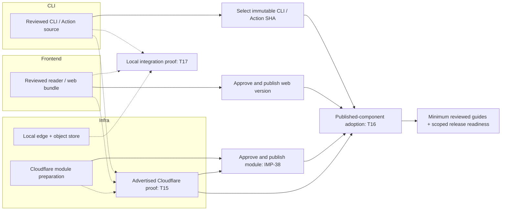

# Component lanes and dependency map

[Release execution order](release-readiness.md) · [Delegation and owner handoffs](delegation.md)

Lanes and dependency map checked on October 2, 2026 (JST). This is a cross-track navigation view, not another ticket queue or specification. Ticket files own status, acceptance criteria and evidence. The lanes below do not change release scope or grant external-change authority. The one exception to "no assignment" is the dated [Current work packages](#current-work-packages-2026-10-11) snapshot, requested by the owner, which says who works on what; it stays subordinate to ticket status and the workspace `STATUS.md`.

## Keep the axes separate

| Axis | Question answered | Source of truth |
| --- | --- | --- |
| Track | Is this a product problem, implementation slice, design decision, verification, or reader-facing page? | Existing backlog directories and their indexes |
| Component lane | Which component primarily changes, and which other components participate? | The map below; record primary and participating lanes in new or substantially revised tickets |
| Dependency | What outcome must exist before this particular step can finish? | The ticket's dependency or acceptance criteria |
| Execution mode | Can an agent proceed locally, or is an owner handoff needed? | [Delegation](delegation.md) and the ticket |
| Release gate | What evidence or approval is required before advertising or publishing this scope? | [Release readiness](release-readiness.md) |

Keep files in their existing tracks. A cross-component item stays one item, with one primary lane and participating lanes; do not create one copy per component. Verification spans lanes rather than becoming another independently shipped component.

## Lanes

| Lane | Owns | Current entry points |
| --- | --- | --- |
| CLI | Config resolution, registry/content publication, projection generation, concurrency/recovery, preview reconciliation; thin Actions wrapping the same operations | [T5](verification/T5-concurrency-recovery.md), [T14](verification/T14-production-reconciliation.md), [T17](verification/T17-local-preview-retirement-e2e.md), [T18](verification/T18-publish-scale-baseline.md), [T19](verification/T19-publish-state-layout-cost.md); completed implementation records remain historical evidence |
| Frontend | Reading, navigation, discovery/search, preview presentation, loading/error states, web bundle | [IMP-42](implementation/IMP-42-fulltext-search-ux.md), [T6](verification/T6-resources-navigation.md), [issue repair order](issues/README.md#repair-order) |
| Infra | Local edge/object-store profiles, provider adapters, delivery/cache/CSP, lifecycle rules, Terraform module packaging | [IMP-37](implementation/IMP-37-cloudflare-entry-module.md), [IMP-38](implementation/IMP-38-terraform-registry-publication.md), [IMP-39](implementation/IMP-39-aws-cloudflare-dns-acm.md) (closed 2026-10-13, removed before release), [T15](verification/T15-provider-delivery.md) |
| Docs / Adoption | Obtainable versions, consumer setup, public documentation and owner review | [T16](verification/T16-external-adoption.md), [documentation queue](documentation/README.md) |

Docs / Adoption is a cross-cutting workstream, not a fourth runtime component. A defect can originate in any lane; use the issue's evidence to determine its primary component rather than assigning all issues to Frontend.

## Current work packages (2026-10-11)

Owner request (2026-10-11): group the open backlog into work packages so Claude and Codex can work in parallel. Each package lists both agents' items and the files each one touches. Tickets still own status and acceptance; the workspace `STATUS.md` holds the live "next" pick for each agent.

| Package | Claude (web/, spec prose, backlog) | Codex (cli/, actions/, workflows, scripts/, terraform/) | Coupling and order |
| --- | --- | --- | --- |
| WS1 Search results and snippets ([TD20](technical-design/TD20-search-results-page-and-snippet-packs.md)) | [ISSUE-087](issues/ISSUE-087-page-text-search-results-page.md) (code merged in #95; the ticket stays In progress until a production check after the web release); [ISSUE-085](issues/ISSUE-085-page-text-search-snippets.md) snippets, headings and body-hit ordering in the reader; [IMP-42](implementation/IMP-42-fulltext-search-ux.md) remaining checks (public guide, cross-OS ⌘⇧F, real IME), re-scoped against ISSUE-087 or closed | [ISSUE-088](issues/ISSUE-088-indexer-rejects-reserved-first-segments.md) reserved segments (Claude did it on owner instruction); [IMP-77](implementation/IMP-77-fulltext-section-table-and-text-packs.md) section table and text packs | IMP-77 lands its format contract and golden fixtures first; then the Go writer (Codex) and the web reader (Claude) proceed in parallel against the fixtures. Shared: `docs/architecture/fulltext-search.md` (Codex writes, Claude reviews). Golden fixtures live under `cli/internal/fulltext/testdata/` (Codex); web tests read them without editing them. TD20 itself stays Open until the format and snippets ship. |
| WS2 Reader navigation ([TD19](technical-design/TD19-navigation-metadata-in-the-site-index.md), web only) | [ISSUE-076](issues/ISSUE-076-pages-sorted-alphabetically-by-title.md) folders-first filename order; [ISSUE-086](issues/ISSUE-086-pages-have-no-related-pages-list.md) related pages; [ISSUE-078](issues/ISSUE-078-landing-page-has-no-orientation.md) remainder (site order, root-README start point) | — (TD19: no index or CLI change) | Independent of every other package. 076 first (086 and 078 reuse its ordering). |
| WS3 Edge 404 and serving | — (web part of ISSUE-083 is done; T6 preview resources/navigation sits in WS7 with Claude because it is reader-side) | [ISSUE-083](issues/ISSUE-083-unknown-urls-return-http-200.md) is Won't fix (2026-10-12: edge 404 declined, soft 404 kept); only [T4](verification/T4-serving-boundary.md) | Independent. Directory pages (ISSUE-075) and `_search` are valid routes. |
| WS4 Release train | Release notes wording; verify the reader on production after deploy | CLI release with ISSUE-088 (and later IMP-77); web release with ISSUE-087 (proposed `web/v0.3.0`; the last web tag is `web/v0.2.0`); operator pin bumps and App deploy | Owner approval per tag, release and production deploy. Ship CLI with ISSUE-088 before or together with the web release that adds `/_search`. |
| WS5 CI and test hygiene | [ISSUE-072](issues/ISSUE-072-modified-click-tab-and-route-fetch-e2e-flaky.md) flaky e2e (`web/e2e/`) | [IMP-78](implementation/IMP-78-ci-runs-all-web-unit-tests.md) run every web unit suite in CI; configurable e2e compose project | Independent. ISSUE-072 touches `web/e2e/` (Claude), IMP-78 touches `scripts/run-e2e.mjs` and workflows (Codex). After IMP-78, Claude adds new web suites to the aggregate script only. |
| WS6 Terraform, AWS and distribution | — | [IMP-39](implementation/IMP-39-aws-cloudflare-dns-acm.md) (closed 2026-10-13, removed before release), [IMP-44](implementation/IMP-44-aws-waf-custom-rules.md), [IMP-64](implementation/IMP-64-generate-sync-terraform-packages.md), [IMP-38](implementation/IMP-38-terraform-registry-publication.md), [TD15](technical-design/TD15-terraform-module-source-of-truth.md), [IMP-73](implementation/IMP-73-registry-setup-command.md), [IMP-66](implementation/IMP-66-per-site-control-prefix-and-aws-iam.md) last slice, [T15](verification/T15-provider-delivery.md); verification [T5](verification/T5-concurrency-recovery.md), [T8](verification/T8-stale-reference-cleanup.md), [T14](verification/T14-production-reconciliation.md) | Codex-only; owner approvals for applies and Registry publication. IMP-66 is handed to Codex for its last slice (Assignee updated 2026-10-11). [IMP-48](implementation/IMP-48-operator-repository-split.md) (Open): the admin/docs split happened on 2026-10-06; Codex reconciles the ticket with what remains or closes it. |
| WS7 Docs and adoption | Docs site pages (DOC-02..13 in the `docs` repository), content feedback (heading ids, CLI pin in Getting started, storage map width), [T6](verification/T6-resources-navigation.md) | [IMP-46](implementation/IMP-46-action-marketplace-release.md) at the first non-pre-release; [T16](verification/T16-external-adoption.md) with the owner | Docs come last (owner): after WS1–WS4 ship, Claude runs the cold-start adoption trial, then pages. |

The live next pick per agent is kept in the workspace `STATUS.md`, not here. Deliberately omitted: [TD7](technical-design/TD7-per-site-fulltext-opt-out.md) (Deferred) and the DOC tickets, which are covered by WS7 as a group.

File boundaries that need care: `docs/specification.md` (each agent edits only its own sections), `docs/backlog/*/README.md` (each agent edits only its own rows), root `package.json` (Codex owns scripts; Claude may add web suites to the aggregate after IMP-78), and `web/src/domain/fulltext-codec.ts` (Claude; it must match the IMP-77 contract).

## Dependency meanings

- **Requires:** a hard prerequisite for the named step. State the required outcome, not merely another ticket ID. A completed prerequisite does not remain a blocker.
- **Verified by:** a test or measurement consumes several components to prove a shared contract. This does not imply that all component development must run sequentially.
- **Release gate:** package preparation may proceed, but publication or a support claim waits for the specified proof/approval.
- **Related:** context only; do not infer a blocker.

If a ticket currently lists several meanings together under `Depends on`, preserve its accepted constraints and clarify the relation when revising that ticket. This overview does not silently remove existing gates.

## Shared proofs

| Proof | Primary lane | Participating lanes | Required outcome / boundary |
| --- | --- | --- | --- |
| [T17: local preview retirement](verification/T17-local-preview-retirement-e2e.md) | CLI | Frontend, Infra | Actual CLI publication and reconciliation + local object-store deletion + warm-browser withdrawal. Existing local infrastructure is the foundation; no cloud expiry wait or new cleanup workflow. |
| [T18: publisher scale baseline](verification/T18-publish-scale-baseline.md) | CLI | Infra | Compare state-assisted fast-path and explicit-origin-reconciliation behavior with the recorded in-memory and pre-change Cloudflare baseline; candidate provider results remain pending, and CLI changed-object counts do not stand in for adapter request/byte metrics. |
| [T19: publish-state layout and provider cost](verification/T19-publish-state-layout-cost.md) | CLI | Infra | Compare the current flat state and safe directory/shard prototypes against identical real builder outputs, including recovery and retained-state cost; provider pricing models stay separate from measured provider-wire requests and common projection work. |
| [T4: serving/cache](verification/T4-serving-boundary.md) and [T6: resources/navigation](verification/T6-resources-navigation.md) | Frontend | CLI, Infra | Published artifacts/resources are served and navigated under the accepted HTTP/trust contract. Local proof does not establish live-provider behavior. |
| [T5: concurrency](verification/T5-concurrency-recovery.md) and [T14: production reconciliation](verification/T14-production-reconciliation.md) | CLI | Infra | Correct operation under conditional writes, retries, interruptions and competing publication. Provider-specific evidence stays distinct. |
| [T8: stale references](verification/T8-stale-reference-cleanup.md) | CLI | Frontend, Infra | Missing-object reconciliation and reader behavior; T17 provides a repeatable local integration proof, while lifecycle behavior remains provider evidence. |
| [T15: provider delivery](verification/T15-provider-delivery.md) | Infra | CLI, Frontend | Real delivery/publication/lifecycle evidence for each advertised provider. Cloudflare, AWS and emulator-only GCP must not be collapsed into one support claim. |
| [T16: external adoption](verification/T16-external-adoption.md) | Docs / Adoption | CLI, Frontend, Infra | A clean consumer (new public repository, own Cloudflare bucket and hostname) follows only the public guide and uses the independently versioned released CLI, web bundle, Actions and Cloudflare module, then proves setup and web upgrade/rollback. Local smoke candidates are preparation, not published-component adoption. |

## Release convergence, not a single serial queue

Solid arrows below mean a prerequisite for that convergence step. Dotted arrows mean inputs to a shared proof. They are not a calendar or new blanket requirement to complete every listed ticket before any release.

Module packaging, web packaging, Action pin preparation and documentation drafts can progress in parallel. The diagram groups owner approvals with their publication step; it does not grant that approval. Public guide finalization must describe the tested, obtainable components, but drafting need not wait for publication.

CLI/Actions use an immutable source SHA; web bundles have their own versions; Terraform modules have independent per-module SemVer, released by per-module tags and synced to generated package repositories ([TD15](technical-design/TD15-terraform-module-source-of-truth.md), [TD2](technical-design/TD2-component-release-policy.md), [IMP-38](implementation/IMP-38-terraform-registry-publication.md)). There is no umbrella version or automatic app redeployment for a CLI-only change.

AWS composition/proof is a separate Infra branch. It does not block a scoped Cloudflare-first release. GCP remains emulator-only. IMP-42 can advance in the Frontend lane independently; this map does not newly designate it or unrelated UI polish an initial-release gate.

## How to use this view

1. Find work in the existing track/repair queue, then identify its primary lane and participating lanes.
2. Read the required outcome of each dependency. Distinguish implementation prerequisites from verification and publication gates.
3. Delegate independent local work in parallel within the existing owner boundaries. Shared files still require coordination even when tickets belong to different lanes.
4. Record results/status in the ticket and synchronize its track index. Update this map only when relationships or scope change, not for every status transition.
5. Follow release readiness for the next external handoff. A green component lane alone does not establish end-to-end adoption readiness.

## Backend next wave (2026-10-18)

Sol owns backend decisions under the October 18 delegation rule; Claude main owns public docs/reader decisions, delegates implementation to Luna and arranges cross review. This section supersedes older backend next-step statements in the dated work-package snapshot without replacing that history. Ticket files remain authoritative.

1. **Record work done.** Close TD15/TD20 as settled designs and T6 as completed local/emulator proof. Credit Registry publication/retrieval, IMP-66 rollout, default-prefix OIDC, T22 and the named Cloudflare recovery/withdrawal samples. Keep IMP-38 record review/T16 handoff and IMP-66 live DOC-29/30 coverage open. IMP-48's remaining source cleanup is decided (delete duplicate monorepo sources in a follow-up coordinated with Claude); IMP-44 evaluated plans are Deferred until concrete WAF demand.
2. **Non-cloud checks.** The [October 18 hosted fixture preparation](verification/hosted-fixture-preparation-2026-10-18.md) records exact branches/PRs, pins, assertions and mutations (F64/F73; approvals A1–A3 in the coordinated plan). [IMP-64](implementation/IMP-64-generate-sync-terraform-packages.md) hosted PR guards in both package repositories are done 2026-10-18 (A1). [IMP-73](implementation/IMP-73-registry-setup-command.md) registry, caller-environment and private/private MinIO fixture cases are done 2026-10-18 (A2/A3); only its non-default `aws.namePrefix` runtime criterion remains, under the separate AWS/T15 gate. No hosted fixture work remains.
3. **Implement [ISSUE-112](issues/ISSUE-112-aws-large-generated-json-delivery.md).** Luna follows the settled AWS gzip policy, CLI 0.5.0 minimum, compatible Action preparation and rollback boundary. Complete deterministic, migration/recovery, shallow-history and controlled HTTP/browser checks before proposing release or live rollout. Owner approval remains required for actual tags/publication and operator changes.
4. **Execute the coordinated proof directly from Claude main.** The [October 20 superseding decision](verification/provider-proof-plan-2026-10-18.md#superseding-execution-decision--october-20-2026) keeps the single P1–P10 ledger for T4/T5/T8/T14/T15 and IMP-73. A1–A3 are complete; existing A4–A9 approvals and combined caps remain valid, with exact commands/plans/pins reviewed and chat OK before transitions. Cancel remaining launcher, signatures/seals, invocation-registry, credential-verification-record and fake coordinator work; retain [standalone policies](../../scripts/provider-proof/policies/). Run supported cases; unsupported P4–P7 cells stay open/not-run. Full Cloudflare refresh waits for owner dashboard confirmation of read-only groups; content/metadata inventory may proceed. Stop before A4’s 30-minute/usage allowance would be exceeded and request an estimated extension. Retain hosted OIDC jobs, preservation, A8-short/A9 readiness/cleanup sequencing, no production credentials/requests and owner-supplied production evidence for retained experiments. WAF and alternate-egress/device work remain separately gated.
   **Regression follow-up:** [IMP-81](implementation/IMP-81-provider-release-regression-workflow.md) implements `provider-regression.yml`; [T28](verification/T28-provider-release-regression.md) records recurring evidence. Use dedicated regression sites and exclusive windows on the existing verification stacks only with explicit future authorization. Run after verified publication, before rollout; no routine Terraform apply or production secrets.
5. **Then [T16](verification/T16-external-adoption.md) / [IMP-46](implementation/IMP-46-action-marketplace-release.md).** Hand off IMP-38's exact Registry evidence, finish Claude's final public docs, then rerun clean-consumer adoption against obtainable released components; trial A and `terraform init` are partial evidence. Prepare the first full-release/four-listing/immutable-release checklist only after the adoption gate. Accounts, real devices, applies, releases, Marketplace/Registry publication and repository settings remain explicit owner gates. Do not merge or release based on this bookkeeping plan alone.
